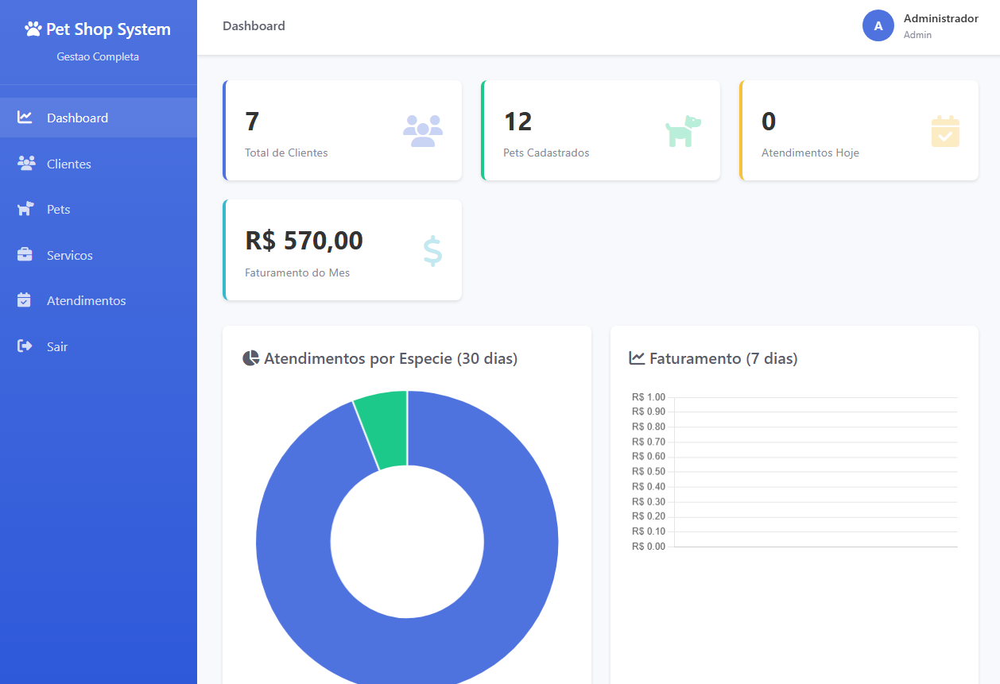
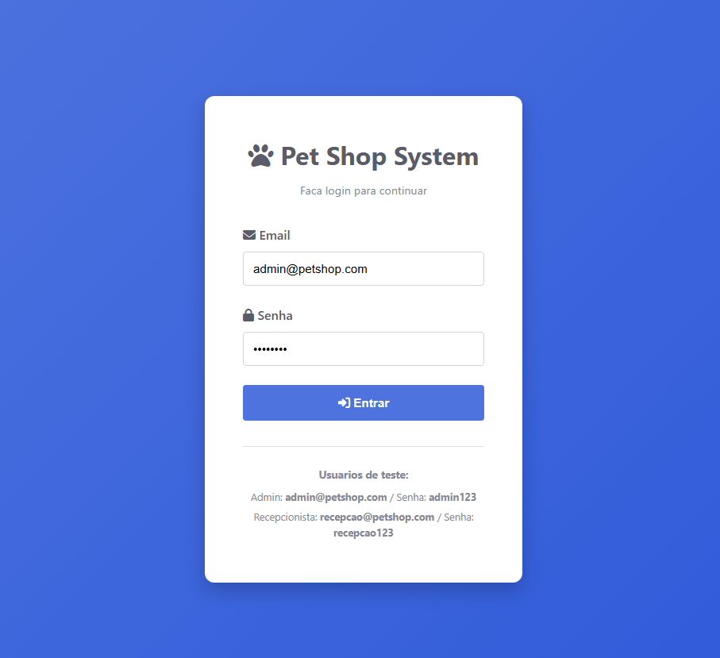
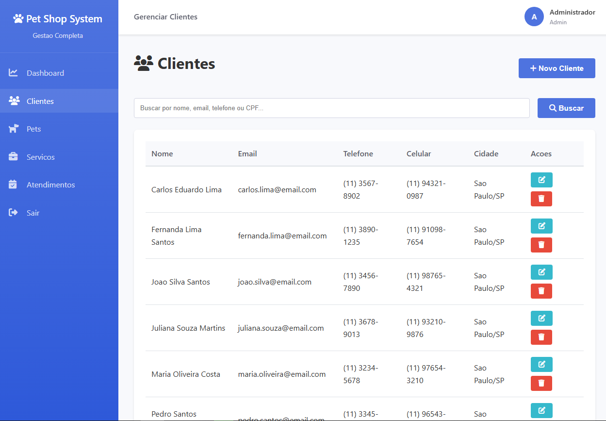
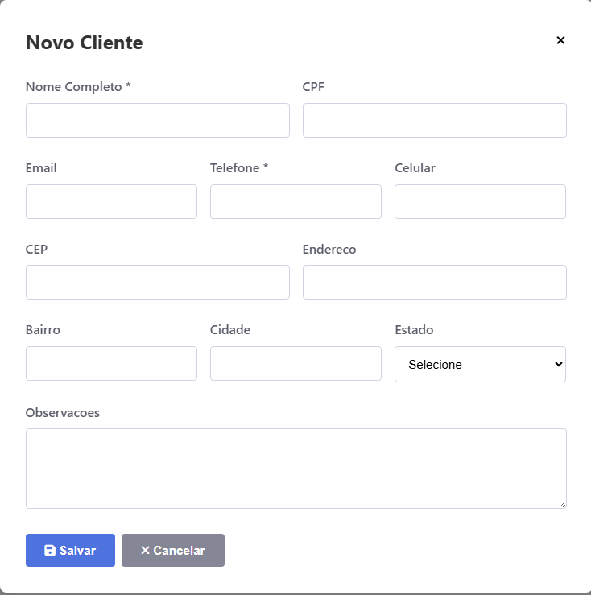
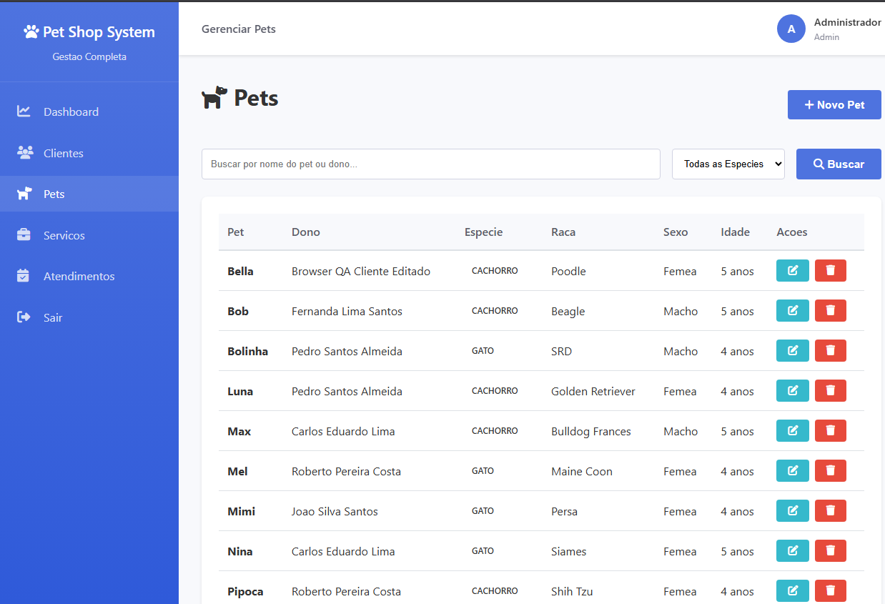
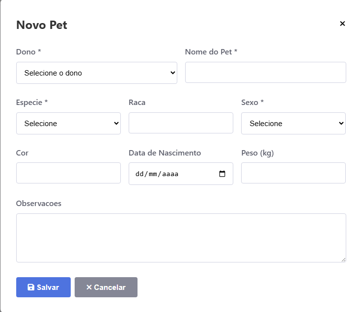
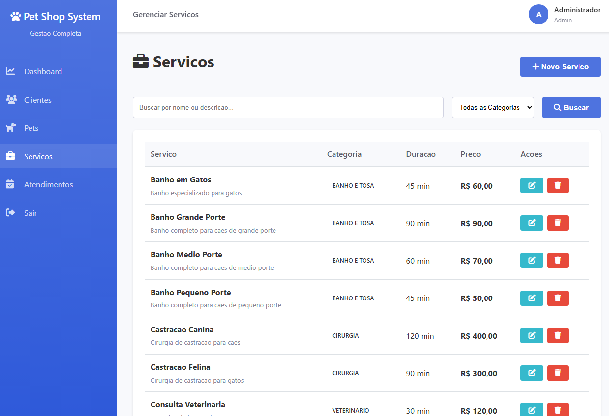
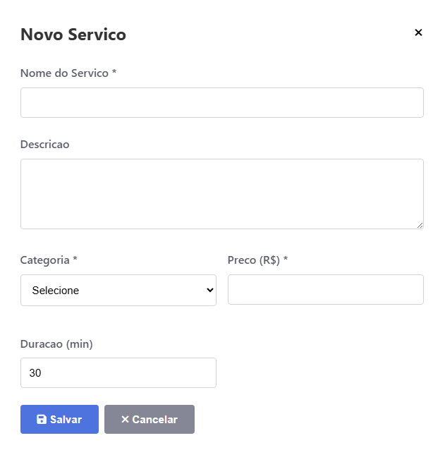
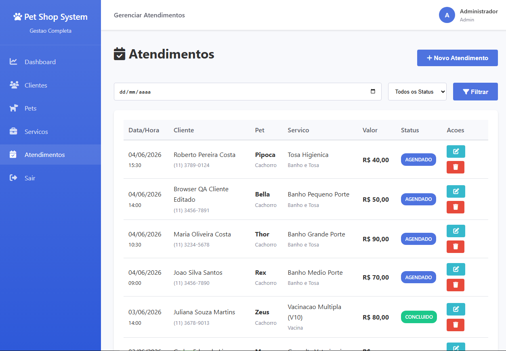
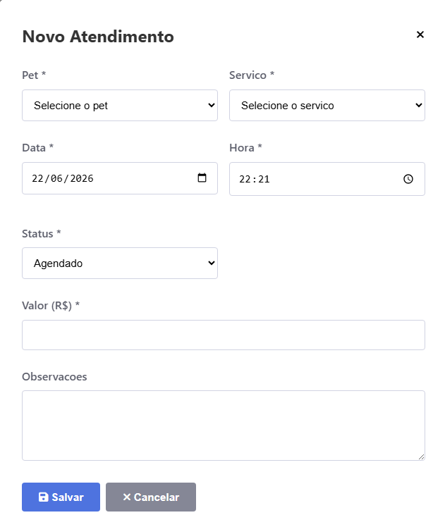

## Pet System V2

[](https://www.php.net/)
[](https://www.mysql.com/)
[](https://developer.mozilla.org/en-US/docs/Web/HTML)
[](https://developer.mozilla.org/en-US/docs/Web/CSS)
[](https://developer.mozilla.org/en-US/docs/Web/JavaScript)
[](https://www.chartjs.org/)
[](https://fontawesome.com/)

Operational management system for pet shops and veterinary clinics, developed in PHP with MySQL/MariaDB!

## 📖 About the project

## Project status

**V2 is stable and complete** and remains publicly available on GitHub.

## Project objective

The system was developed based on needs observed in a real pet shop environment. The public version uses demo, fictitious, and sanitized data to preserve the privacy of the original data.

## Problem solved

The routine of pet shops and veterinary clinics involves managing related clients, pets, services, and appointments.

When this information is managed in a fragmented way, problems arise, such as:

- Difficulty locating client and pet history;
- loss of appointment information;
- lack of standardization in scheduling statuses;
- limited visibility into completed services and revenue;
- excessive steps during reception service.

PetShop System V2 centralizes these operations in a single system with a direct workflow:

**client → pet → service → appointment → dashboard tracking**

## Features

| Module | Features |
| ------------------------------ | ---------------------------------------------------------------------- |
| Authentication | Login, logout, and identification of administrator and receptionist profiles |
| Clients | Registration, viewing, editing, searching, and deactivation |
| Pets | Client-linked registration, editing, filtering, and deactivation |
| Services | Price, duration, and category registration, editing, filtering, and deactivation |
| Appointments | Scheduling, editing, deletion, notes, and status control |
| Dashboard | Operational indicators, revenue, and charts |
| Filters | Search by text, species, category, date, and status |
| Development tools | Auxiliary scripts for installation, connection, and functional testing |

Appointments can use the following statuses:

- Scheduled;
- In Service;
- Completed;
- Cancelled.

## 🖼️ Screenshots

### Dashboard



### Login



### Clients



## New Client



## Pets



## New Pet



## Services



## New Service



## Appointments



## New Appointment



## 🚀 Technologies

- **Backend:** PHP
- **Database access:** MySQLi
- **Database:** MySQL or MariaDB
- **Frontend:** HTML5, CSS3, and JavaScript
- **Charts:** Chart.js
- **Icons:** Font Awesome
- **Encoding:** UTF-8 and `utf8mb4`
- **Recommended local environment:** Windows with XAMPP
- **Web server:** Apache

## Applied security

V2 includes security measures applied to the context of a procedural PHP application:

- password storage with `password_hash()`;
- password validation with `password_verify()`;
- prepared statements for variable inputs;
- HTML output escaping with `htmlspecialchars()`;
- CSRF tokens in forms;
- secure token comparison with `hash_equals()`;
- session identifier regeneration after login;
- session cookies with `HttpOnly` and `SameSite=Lax`;
- strict session mode;
- blocking internal pages for unauthenticated users;
- database error messages without direct exposure of credentials;
- blocking web access to the `config`, `scripts`, and `sql` folders through `.htaccess`;
- basic HTTP protection headers through Apache when the headers module is enabled.

In production, the `Secure` attribute of the session cookie is enabled when the application is accessed over HTTPS.

> The existing measures reduce common risks such as SQL Injection, XSS, CSRF, exposure of internal files, and insecure session usage. They do not replace secure server and hosting configuration.

## Technical learnings

V2 development consolidated important practices for procedural PHP applications:

- Modular organization without replacing the existing architecture;
- consistent use of prepared statements;
- form protection with CSRF tokens;
- safer session management;
- data escaping in HTML output;
- maintenance of relationships between clients, pets, and appointments;
- use of logical deactivation to preserve historical references;
- database and application standardization with UTF-8/`utf8mb4`;
- separation between application code and development tools;
- creation of functional tests for critical flows;
- data sanitization before publication;
- application configuration for different environments through environment variables.

The evolution from V1 to V2 focused on stability, security, organization, and operational predictability while keeping the implementation in procedural PHP.

## ⚙️ How to run

### Requirements

- PHP 7.4 or higher (a newer version is recommended);
- MySQL 5.7+, MariaDB, or a compatible version;
- Apache;
- MySQLi extension enabled;
- XAMPP recommended for local execution on Windows.

## Local installation with XAMPP

1. Clone the repository or copy the project to the Apache directory:

   ```powershell
   Copy-Item ".\Petshopsystemv2" "C:\xampp\htdocs\" -Recurse -Force
   ```

2. Start Apache and MySQL through the XAMPP Control Panel.

3. Create and configure the database according to the next section.

4. Access:

   ```text
   http://localhost/Petshopsystemv2/
   ```

## Database configuration file

The `config/database.php` file contains the actual database connection details and must not be committed.

The public repository includes only the safe template:

```text
config/database.example.php
```

To configure the project, copy the template:

```powershell
Copy-Item ".\config\database.example.php" ".\config\database.php"
```

Then fill in `config/database.php` with the real details only in the local or server environment. Never send real credentials to GitHub.

## Hosting environment configuration

The application accepts the following environment variables:

```env
APP_ENV=production
BASE_URL=https://your-domain.example/
DB_HOST=localhost
DB_USER=your_user
DB_PASS=your_password
DB_NAME=your_database
```

The `.env.example` file serves as a reference. The application reads variables provided by the PHP server environment; it does not automatically load a `.env` file.

Before publishing:

- use HTTPS;
- use a dedicated database user without administrator privileges;
- configure `BASE_URL` correctly;
- do not publish real credentials;
- do not commit `config/database.php`;
- change the passwords of demo users;
- keep `config/`, `scripts/`, and `sql/` outside public access;
- confirm that the `.htaccess` rules are respected by the server;
- disable directory listing;
- keep logs, backups, sessions, and temporary files outside the repository.

### Database configuration

## Import through phpMyAdmin

1. Open `http://localhost/phpmyadmin`.
2. Create the `petshop_system` database.
3. Use `utf8mb4` encoding.
4. Open the **Import** tab.
5. Select:

   ```text
   sql/database.sql
   ```

6. Run the import.

## Import through the command line

In PowerShell:

```powershell
cmd.exe /c '"C:\xampp\mysql\bin\mysql.exe" -u root -e "CREATE DATABASE IF NOT EXISTS petshop_system CHARACTER SET utf8mb4 COLLATE utf8mb4_unicode_ci;"'

cmd.exe /c '"C:\xampp\mysql\bin\mysql.exe" -u root petshop_system < "C:\xampp\htdocs\Petshopsystemv2\sql\database.sql"'
```

If the MySQL user has a password, add `-p` and enter the password when prompted.

## Default development configuration

The default local configuration uses:

```text
Host: localhost
User: root
Password: empty
Database: petshop_system
```

These values can be replaced by the following variables:

- `DB_HOST`;
- `DB_USER`;
- `DB_PASS`;
- `DB_NAME`;
- `BASE_URL`;
- `APP_ENV`.

## Demo users

The public database includes fictitious accounts for local evaluation:

| Profile | E-mail | Password |
| ------------- | ---------------------- | ------------- |
| Administrator | `admin@petshop.com` | `admin123` |
| Receptionist | `recepcao@petshop.com` | `recepcao123` |

> These credentials are for demonstration only. In a real production environment, change or remove these accounts before making the application available.

### Tests

#### Connection verification

To verify the connection and the existence of the required tables:

```powershell
& php ".\scripts\dev\test_db.php"
```

If PHP is not available in the `PATH`, use:

```powershell
& "C:\xampp\php\php.exe" ".\scripts\dev\test_db.php"
```

## Automated functional test

The project includes a PowerShell script that uses an isolated database to validate:

- administrator login;
- receptionist login;
- logout;
- client CRUD;
- pet CRUD;
- service CRUD;
- appointment CRUD;
- dashboard;
- filters;
- CSRF protection;
- private page blocking;
- session cookie attributes.

Run the test:

```powershell
powershell -ExecutionPolicy Bypass -File ".\scripts\dev\functional_test.ps1"
```

By default, the test uses the following database:

```text
petshop_system_v2_test
```

Create this database and import `sql/database.sql` before running the test.

> Run the functional test only on an isolated database. The script creates, changes, and removes records during validation.

## Recommended manual verification

1. Log in with a demo user.
2. Register a client.
3. Register a pet linked to the client.
4. Register or select a service.
5. Create an appointment.
6. Update the appointment status.
7. Check the indicators on the dashboard.
8. Test the module filters.
9. End the session.
10. Try to access an internal page without logging in and confirm the redirect.

## 📂 Project structure

```text
Petshopsystemv2/
├── assets/
│   ├── css/
│   │   └── style.css
│   └── js/
│       └── main.js
├── config/
│   ├── config.php
│   ├── database.example.php
│   └── database.php
├── includes/
│   ├── footer.php
│   └── header.php
├── pages/
│   ├── atendimentos.php
│   ├── clientes.php
│   ├── dashboard.php
│   ├── login.php
│   ├── logout.php
│   ├── pets.php
│   └── servicos.php
├── scripts/
│   └── dev/
│       ├── auto_setup.ps1
│       ├── functional_test.ps1
│       ├── reset_passwords.php
│       └── test_db.php
├── sql/
│   └── database.sql
├── .env.example
├── .htaccess
├── index.php
└── README.md
```

## Main responsibilities

- `assets/`: interface styles and scripts;
- `config/`: general settings, session, and database connection;
- `includes/`: shared interface components;
- `pages/`: application functional modules;
- `scripts/dev/`: auxiliary development and testing tools;
- `sql/`: database structure and demo data.

## 👤 Author

**Natan Da Luz**

- E-mail: [natandaluz01@gmail.com](mailto:natandaluz01@gmail.com)
- LinkedIn: [linkedin.com/in/natandaluz](https://www.linkedin.com/in/natandaluz/)
- Portfolio: [portfolionatan.vercel.app](https://portfolionatan.vercel.app/)

Project developed based on a real pet shop operation.
